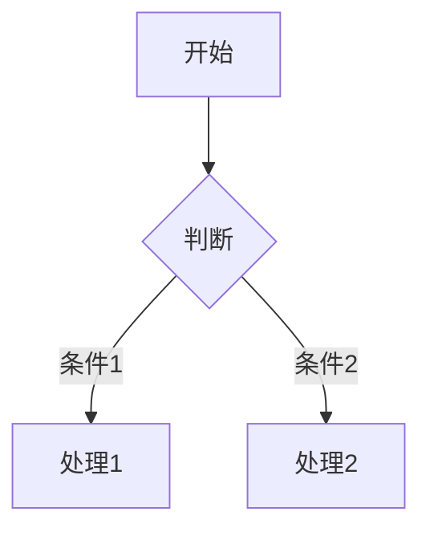

# Format Hub

一个简洁的 Markdown 转微信公众号排版工具。左侧写 Markdown，右侧实时预览公众号效果，一键导出 HTML / PDF。


## 功能特点

- **实时预览** - Markdown 编辑与公众号预览同步更新
- **系列化主题** - 5 大系列 35+ 种排版风格
- **代码高亮** - 4 种代码主题可选（GitHub、Atom One、Dracula、Nord）
- **数学公式** - 支持 KaTeX 渲染行内和块级公式
- **Mermaid 图表** - 支持流程图、时序图等图表渲染
- **脚注支持** - `[^1]` 语法，自动编号和跳转
- **目录生成** - 一键生成文章目录导航
- **富文本复制** - 一键复制到公众号编辑器，保留完整排版
- **PDF 导出** - 支持 A4/Letter、页边距、字体、标题、页眉页脚
- **安全渲染** - 使用 DOMPurify 过滤危险标签
- **自动保存** - 内容自动保存到本地存储

## 支持语法

### 基础语法
- 标题 H1-H6
- **粗体**、*斜体*、==高亮==、~~删除线~~
- [链接](https://example.com)、图片
- 有序/无序列表
- 引用块
- 代码块与行内代码
- 表格
- 分割线

### 扩展语法

**数学公式**
```markdown
行内公式：$E = mc^2$

块级公式：
$$\int_{a}^{b} f(x) \mathrm{d}x = F(b) - F(a)$$
```

**Mermaid 图表**
````markdown

```

**脚注**
```markdown
这是一个句子[^1]。

[^1]: 这是脚注的内容。
```

## 快速开始

```bash
# 安装依赖
npm install

# 启动开发服务器
npm run dev

# 构建生产版本
npm run build

# 预览生产构建
npm run preview
```

## 主题系统

主题按**系列 × 颜色**矩阵组织，共 5 大系列 35+ 种风格：

### Classic 经典系列
适合传统公众号文章，保留原有 3 个经典主题：

| 主题 | 风格 | 适合场景 |
|------|------|----------|
| 杂志风 | 优雅复古 | 长文阅读、文艺内容 |
| 冷静科技 | 现代简洁 | 技术文章、教程 |
| 简报风 | 商务正式 | 资讯、新闻稿 |

### Minimal 极简系列
干净克制，纯色文字无装饰，适合阅读类内容：

| 颜色 | 主题 | 特点 |
|------|------|------|
| 金 | Minimal · 金 | 温暖专业 |
| 绿 | Minimal · 绿 | 清新自然 |
| 蓝 | Minimal · 蓝 | 专业可靠 |
| 橙 | Minimal · 橙 | 活力热情 |
| 红 | Minimal · 红 | 醒目突出 |
| 藏青 | Minimal · 藏青 | 沉稳商务 |
| 灰 | Minimal · 灰 | 中性百搭 |
| 天蓝 | Minimal · 天蓝 | 清爽科技 |

### Focus 居中系列
居中对称，标题上下双横线，适合强调结构：

| 颜色 | 主题 | 特点 |
|------|------|------|
| 金 | Focus · 金 | 庄重典雅 |
| 绿 | Focus · 绿 | 平衡和谐 |
| 蓝 | Focus · 蓝 | 专注专业 |
| 橙 | Focus · 橙 | 热情醒目 |
| 红 | Focus · 红 | 强烈视觉冲击 |
| 藏青 | Focus · 藏青 | 权威稳重 |
| 紫 | Focus · 紫 | 神秘优雅 |
| 青 | Focus · 青 | 清新独特 |

### Elegant 优雅系列
层次丰富，左边框递减 + 渐变背景，适合精品内容：

| 颜色 | 主题 | 特点 |
|------|------|------|
| 金 | Elegant · 金 | 奢华精致 |
| 紫 | Elegant · 紫 | 浪漫神秘 |
| 玫瑰 | Elegant · 玫瑰 | 温馨柔美 |
| 绿 | Elegant · 绿 | 自然雅致 |
| 蓝 | Elegant · 蓝 | 深邃优雅 |
| 橙 | Elegant · 橙 | 活力温暖 |
| 青 | Elegant · 青 | 独特清新 |
| 靛蓝 | Elegant · 靛蓝 | 深邃专业 |

### Bold bold系列
视觉冲击，标题满底色 + 圆角投影，适合营销内容：

| 颜色 | 主题 | 特点 |
|------|------|------|
| 橙 | Bold · 橙 | 热情奔放 |
| 红 | Bold · 红 | 强烈醒目 |
| 紫 | Bold · 紫 | 神秘高贵 |
| 蓝 | Bold · 蓝 | 专业 bold |
| 绿 | Bold · 绿 | 生机 bold |
| 金 | Bold · 金 | 奢华 bold |
| 藏青 | Bold · 藏青 | 权威 bold |
| 青 | Bold · 青 | 活力 bold |

### 代码主题

| 主题 | 特点 |
|------|------|
| GitHub | 经典风格，浅色/深色双版本 |
| Atom One | 清晰简洁，浅色/深色双版本 |
| Dracula | 流行的暗色主题 |
| Nord | 北极蓝调暗色主题 |

## 项目结构

```
src/
├── App.jsx           # 主应用组件
├── main.jsx          # 应用入口
├── core/
│   ├── markdown.js   # Markdown 渲染、数学公式、图表、脚注
│   ├── clipboard.js  # 富文本剪贴板内容构建
│   └── pdf.js        # PDF 导出设置、标题提取、页边距解析
├── themes/
│   └── index.js      # 主题样式定义（5 大系列 35+ 主题）
└── styles.css        # 全局样式
```

## 技术栈

- **React 18** - UI 框架
- **Vite** - 构建工具
- **Marked** - Markdown 解析
- **KaTeX** - 数学公式渲染
- **Mermaid** - 图表渲染
- **DOMPurify** - HTML 安全过滤

## 使用说明

1. 在左侧编辑器中粘贴或输入 Markdown 内容
2. 在顶部工具栏选择：
   - **排版主题** - 按系列组织，快速切换风格
   - **代码主题** - 控制代码块高亮风格
   - **深色代码** - 切换代码块亮/暗主题
   - **显示目录** - 在文章开头添加目录
3. 右侧预览区实时查看排版效果
4. 点击「复制到公众号」、「导出 HTML」或「导出 PDF」获取最终内容
5. 如需 PDF 版式控制，点击「PDF 设置」调整纸张、字体、标题、页眉页脚和页边距
6. 粘贴到微信公众号编辑器中即可

## 复制功能说明

点击「复制到公众号」会复制**富文本格式**（而非 HTML 源码），你可以直接粘贴到微信公众号编辑器，看到的就是排版好的效果。

**原理：** 使用 Clipboard API 的 `write()` 方法，写入 `text/html` 类型的数据；如果浏览器不支持，则降级使用 `execCommand('copy')` 方法。

---

**注意**：本项目仅供个人使用，导出的 HTML 可直接粘贴到微信公众号后台使用。
