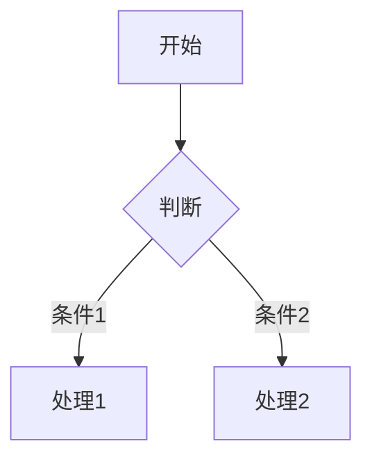

# Format Hub

一个简洁的 Markdown 转微信公众号排版工具。左侧写 Markdown，右侧实时预览公众号效果，一键导出 HTML / PDF。


## 功能特点

- **实时预览** - Markdown 编辑与公众号预览同步更新
- **场景主题** - 8 个高质量场景主题，覆盖阅读、长文、技术、简报、营销等内容类型
- **主题样张** - 同一篇 Markdown 批量预览 8 个主题，点击样张即可切换
- **表达组件** - 支持摘要、提示、洞察、风险、步骤、对比、FAQ、术语等结构化内容块
- **代码高亮** - 4 种代码主题可选（GitHub、Atom One、Dracula、Nord）
- **数学公式** - 支持 KaTeX 渲染行内和块级公式
- **Mermaid 图表** - 支持流程图、时序图等图表渲染
- **脚注支持** - `[^1]` 语法，自动编号和跳转
- **目录生成** - 一键生成文章目录导航
- **富文本复制** - 一键复制到公众号编辑器，保留完整排版
- **多模式导出** - 支持公众号 HTML、独立阅读版 HTML 和 PDF
- **PDF 导出** - 支持 A4/Letter、页边距、字体、标题、页眉页脚
- **安全渲染** - 使用 DOMPurify 过滤危险标签
- **自动保存** - 内容自动保存到本地存储

## 产品方向

Format Hub 已从“系列 × 颜色”的主题矩阵转向少量高质量的场景主题，并把复杂度投入到摘要、提示、洞察、风险、步骤、FAQ、术语、时间线等表达组件上。

详细计划见 [主题收敛与表达能力增强计划](docs/theme-expression-plan.md)。

## 支持语法

### 基础语法
- 标题 H1-H6
- **粗体**、*斜体*、==高亮==、~~删除线~~
- [链接](https://example.com)、图片
- 有序/无序列表
- 引用块
- 代码块与行内代码
- 表格
- 分割线

### 扩展语法

**数学公式**
```markdown
行内公式：$E = mc^2$

块级公式：
$$\int_{a}^{b} f(x) \mathrm{d}x = F(b) - F(a)$$
```

**Mermaid 图表**
````markdown

```

**脚注**
```markdown
这是一个句子[^1]。

[^1]: 这是脚注的内容。
```

**表达组件**
```markdown
:::summary
这是一段文章摘要。
:::

:::insight 为什么要这样设计？
洞察块适合承载核心判断、关键结论或设计理由。
:::

:::risk 注意事项
风险块适合说明限制、前提和迁移风险。
:::
```

支持的组件类型：

| 语法 | 用途 |
|------|------|
| `:::summary` | 文章摘要 |
| `:::note 标题` | 补充说明 |
| `:::insight 标题` | 观点洞察 |
| `:::risk 标题` | 风险提示 |
| `:::steps 标题` | 步骤流程 |
| `:::compare 标题` | 对比分析 |
| `:::faq 标题` | 常见问题 |
| `:::term 名称` | 术语解释 |

## 快速开始

```bash
# 安装依赖
npm install

# 启动开发服务器
npm run dev

# 构建生产版本
npm run build

# 预览生产构建
npm run preview
```

## 主题系统

当前版本提供 8 个场景主题：

| 主题 | 适合内容 | 排版重点 |
|------|----------|----------|
| 默认阅读 | 大多数公众号文章 | 克制、稳定、段落舒适 |
| 深度长文 | 研究、观点、产业链分析 | 标题层级、引用、注释、表格 |
| 技术教程 | 代码教程、开发笔记、公式文章 | 代码块、Mermaid、公式、表格 |
| 商务简报 | 周报、项目汇报、政策解读 | 信息密度、列表、关键结论 |
| 杂志专栏 | 人文、品牌、故事、访谈 | 版面节奏、首屏气质、图片 |
| 重点营销 | 活动、产品介绍、转化型文章 | 强视觉、行动号召、重点块 |
| 知识卡片 | 方法论、清单、术语解释、课程内容 | 摘要、卡片、步骤、FAQ |
| 视觉图解 | 流程、路线图、时间线、图文解释 | 图表、阶段标签、时间标记 |

### 代码主题

| 主题 | 特点 |
|------|------|
| GitHub | 经典风格，浅色/深色双版本 |
| Atom One | 清晰简洁，浅色/深色双版本 |
| Dracula | 流行的暗色主题 |
| Nord | 北极蓝调暗色主题 |

## 项目结构

```
src/
├── App.jsx           # 主应用组件
├── main.jsx          # 应用入口
├── core/
│   ├── markdown.js   # Markdown 渲染、数学公式、图表、脚注
│   ├── clipboard.js  # 富文本剪贴板内容构建
│   └── pdf.js        # PDF 导出设置、标题提取、页边距解析
├── themes/
│   └── index.js      # 主题样式定义
└── styles.css        # 全局样式
```

## 技术栈

- **React 18** - UI 框架
- **Vite** - 构建工具
- **Marked** - Markdown 解析
- **KaTeX** - 数学公式渲染
- **Mermaid** - 图表渲染
- **DOMPurify** - HTML 安全过滤

## 使用说明

1. 在左侧编辑器中粘贴或输入 Markdown 内容
2. 在顶部工具栏选择：
   - **排版主题** - 快速切换文章排版风格
   - **主题样张** - 同屏比较 8 个场景主题并点击切换
   - **代码主题** - 控制代码块高亮风格
   - **深色代码** - 切换代码块亮/暗主题
   - **显示目录** - 在文章开头添加目录
3. 右侧预览区实时查看排版效果
4. 点击「复制到公众号」、「公众号 HTML」、「阅读版 HTML」或「导出 PDF」获取最终内容
5. 如需 PDF 版式控制，点击「PDF 设置」调整纸张、字体、标题、页眉页脚和页边距
6. 粘贴到微信公众号编辑器中即可

## 导出模式

| 模式 | 用途 |
|------|------|
| 复制到公众号 | 复制富文本，适合直接粘贴到微信公众号编辑器 |
| 公众号 HTML | 导出轻量 HTML，适合作为公众号排版内容源 |
| 阅读版 HTML | 导出带完整页面外壳的独立 HTML，适合直接打开、归档和分享 |
| 导出 PDF | 通过桌面版导出 PDF，适合打印和正式交付 |

## 复制功能说明

点击「复制到公众号」会复制**富文本格式**（而非 HTML 源码），你可以直接粘贴到微信公众号编辑器，看到的就是排版好的效果。

**原理：** 使用 Clipboard API 的 `write()` 方法，写入 `text/html` 类型的数据；如果浏览器不支持，则降级使用 `execCommand('copy')` 方法。

---

**注意**：本项目仅供个人使用，导出的 HTML 可直接粘贴到微信公众号后台使用。

## 开发与回归检查

- `npm run electron:dev`：等待本机开发服务就绪后打开桌面窗口，源码修改支持热更新；退出时关闭对应服务。默认使用 5173 端口，端口占用时明确报错。
- `npm test`：运行桌面启动检查及隔离 Electron 窗口中的浏览器回归检查，不读取个人应用草稿，也不写入系统剪贴板。
- `npm run build`：生成生产资源；GitHub 检查会执行相同的测试与构建。

回归检查覆盖草稿在 StrictMode 下的恢复、空草稿保存、代码原文保真、公式与表达组件、微信对齐值转换、独立 HTML 内嵌字体，以及渲染等待期间的导出保护；另覆盖十个以上表达组件、组件内 `$` 字符、代码中的脚注语法、嵌套围栏中的 Mermaid 示例、美元金额与公式的区分、Mermaid 文字与箭头、KaTeX 可伸缩符号，以及排版期间编辑区不跳动。

脚注、表达组件和 Mermaid 在 Markdown 分词阶段识别，代码中的同名语法保持原样。Mermaid 标签使用 SVG 文本，图表单独按 SVG 规则过滤。行内公式要求 `$` 内侧紧贴内容，且结尾 `$` 后不能紧跟数字，`$5 起，$10 封顶` 按普通文字显示。桌面版中点击预览链接会在系统浏览器打开。

复制时会将 `text-align: start/end` 按文字方向转换成 `left/right`，保留居中及两端对齐。修改内容后，复制与导出按钮会等待当前排版完成。导出 HTML 的公式字体直接内嵌；文章引用的远程图片仍需网络访问。

已安装的桌面应用不会自动使用源码修改。需要运行 `npm run build:mac-arm-dmg` 重新打包并安装，网页开发版可直接刷新使用。微信公众号后台的最终粘贴兼容性仍需实际验证。

普通文字复制时使用随字号缩放的比例行高，避免编辑器调整字号后仍保留过小的固定行高；公式在公众号输出中转为高清图片，SVG 的定位样式保持原样。新增用户反馈段落在八个主题中的复制及字号调整回归检查。

### 微信兼容输出（2.1.3）

复制到公众号与公众号 HTML 共用转换：普通文字不输出自定义字体；文字渐变背景转为纯色；代码保留原文与高亮并支持窄屏换行；数学公式转为带白色底色的高清 PNG，避免零高度定位结构与缺失字体。阅读版 HTML 和 PDF 保留原有公式。

官方校验可通过 `npm run check:wechat -- --engine <官方浏览器引擎文件> --out release/wechat-audit` 重复执行；详情、已知误报及验收边界见 [微信兼容说明](docs/wechat-compatibility.md)。此版本没有通过豁免属性隐藏告警。
